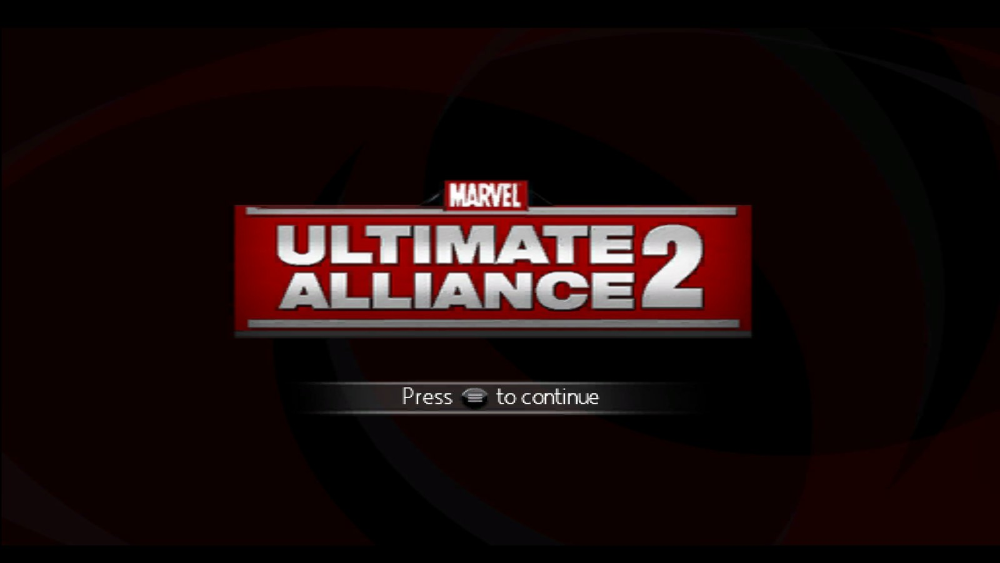
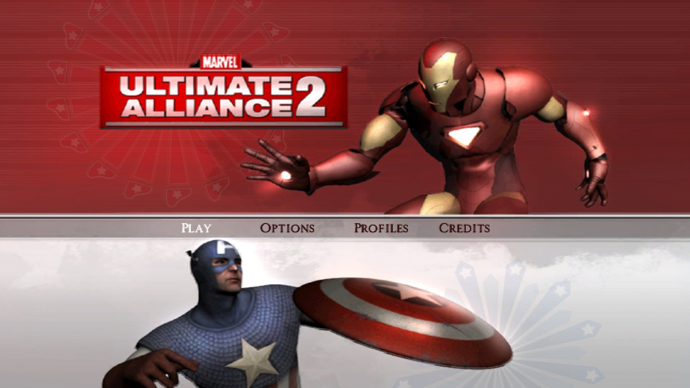
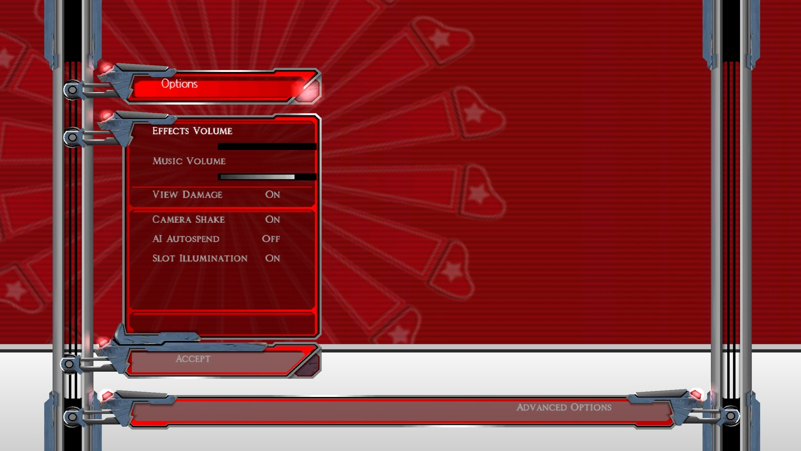
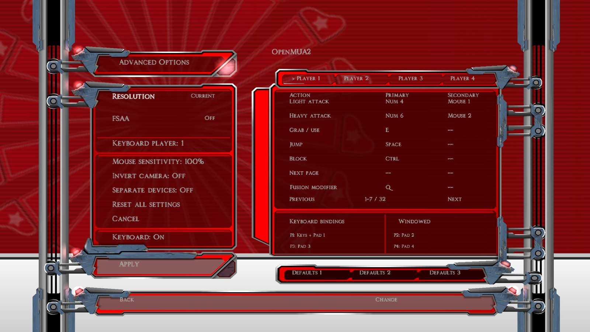
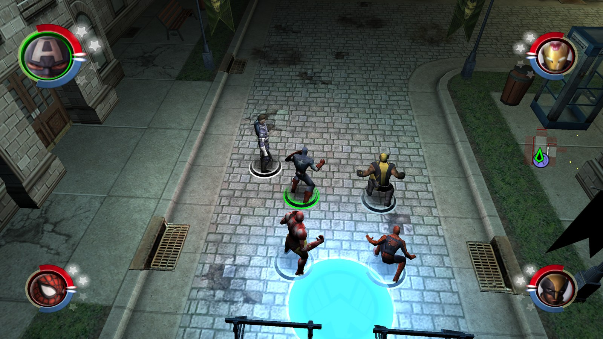
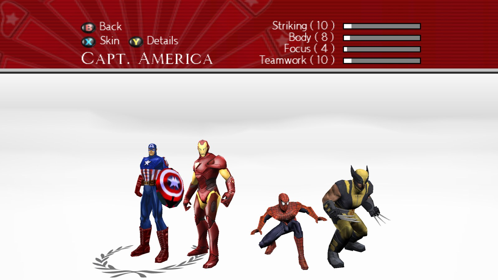

# OpenMUA2

**Marvel: Ultimate Alliance 2, played natively on Windows.**

OpenMUA2 is a PC port of the Wii version of *Marvel: Ultimate Alliance 2* (USA).
It runs the original game on a Dolphin-derived runtime with a JIT CPU backend and
Vulkan rendering, then adds the things a PC version should have: keyboard and mouse
play, Xbox controller support, HD output, and proper in-game PC options menus.

Bring your own disc image, extract the release, run one EXE. No emulator setup,
no config files, no console windows.

> **Current release: 0.9.0b (beta).** Playable, with a few known issues listed below.

## Screenshots

| | |
| --- | --- |
|  |  |
| Title screen | Main menu |
|  |  |
| The red PC Options menu | Advanced Options: resolution, bindings, players |
|  |  |
| In-game, Latveria | Hero Management with Xbox prompts and a classic costume |

## Features

- **Keyboard and mouse play.** Move with WASD, attack with the mouse, fire powers
  from the number keys, and hold to drag the camera with the mouse. Menus work with
  mouse clicks and the scroll wheel.
- **Xbox controller support** out of the box (XInput), with other gamepads
  supported through SDL.
- **Native PC menus.** New red Options and Advanced screens built into the game's
  own menu system, keeping MUA2's original animated backgrounds.
- **Full rebinding.** Primary and secondary bindings for every action on both
  keyboard and controller, three ready-made keyboard layouts, four saved player
  profiles, mouse sensitivity, camera inversion and device assignment. Apply and
  Cancel behave as you'd expect, and a failed save never loses your working setup.
- **HD output.** Choose 720p, 1080p, 1440p or 4K in the Advanced menu; the game
  renders internally at a matching higher resolution. Windowed or borderless
  fullscreen, plus MSAA where your GPU supports it. F11 toggles fullscreen.
- **Bigger roster.** Room for up to 40 heroes (up from 27) for roster mods, with
  saves that store your team and unlocks by name.
- **Classic costumes.** 17 heroes shared with the first *Ultimate Alliance* gain its
  four costumes as alternates (68 in total). Press X (or your Use key) on the
  active-characters page to cycle through them.
- **Controller fixes.** Fusions are on LT and Block is on LB, cleanly separated so
  holding LT never blocks or repeats the fusion sound. Motion-control moments
  (the Wii "shake" prompts) are replaced with rapid button presses.
- **One-click install.** The first launch finds your disc image and sets everything
  up for you.

## Requirements

- 64-bit Windows 10 or 11
- A Vulkan-capable graphics card
- About 3 GB of free disk space for the extracted game
- Your own *Marvel: Ultimate Alliance 2* Wii (USA) disc image (game ID RMSE52)

## Installing

1. Download **OpenMUA2-0.9.0b.zip** from the
   [Releases page](https://github.com/GTTeancum/OpenMUA2/releases) and extract it to
   any folder.
2. Put your own *Marvel: Ultimate Alliance 2* Wii (USA) disc image in the same
   folder. `.wbfs` is recommended; `.iso` and `.rvz` also work. **Game data is not
   included.**
3. Run **OpenMUA2.exe**.

On first launch OpenMUA2 finds your disc image, extracts it into a `GameData`
folder and adds OpenMUA2's own content, showing a progress window while it works
(about half a minute). If there is no image in the folder, or more than one, it
asks you to pick one. The game then starts. Later launches go straight into the
game.

**Where things live** (all beside `OpenMUA2.exe`):

- `saves` - your save games
- `GameData` - the extracted game
- `OpenMUA2.log` - the log file; attach it when reporting a problem

## Controls

All bindings can be changed in **Options**. Keyboard, mouse and controller can be
used together, and you can assign the keyboard and each controller to different
players.

### Keyboard and mouse (default layout)

| Action | Key |
| --- | --- |
| Move | W A S D (hold Shift to walk) |
| Camera | Hold V or the middle mouse button and move the mouse; or I J K L |
| Light attack | Left mouse button (or Numpad 4) |
| Heavy attack | Right mouse button (or Numpad 6) |
| Jump | Space |
| Grab / use | E (tap repeatedly for button-mash prompts) |
| Block | Ctrl |
| Powers 1-4 | 1, 2, 3, 4 |
| Fusion with hero 1-4 | 5, 6, 7, 8 |
| Fusion | Q |
| Switch hero | Arrow keys |
| Pause | Esc |
| Hero Management | F1 |
| Fullscreen | F11 |
| Menus | Mouse, arrow keys, Enter to confirm, Backspace to go back |

Two alternative keyboard layouts are available as presets in Options.

### Xbox controller

| Input | Action |
| --- | --- |
| Left stick | Move; steer the hacking signal |
| Right stick | Camera |
| A | Light attack / menu confirm |
| B | Heavy attack / menu back |
| X | Grab / use |
| Y | Jump |
| LB | Block |
| RT + A/B/X/Y | Powers 1-4 |
| LT + A/B/X/Y | Fusion with the hero in slot 1/2/3/4 |
| D-pad | Switch to hero 1/2/3/4; menu navigation |
| Start / Menu | Pause / resume; continue on title and results screens |
| Back / View | Hero Management |
| Tap X repeatedly | Replaces the Wii motion-control prompts |

Some menus use slightly different controls.

## Known issues

This is a beta. The main things you may notice:

- **Mission results screen:** a fix for the screen not advancing is included but
  still being confirmed. The B.R.A.G. and Leaders tabs still appear there.
- **Camera:** the right stick can feel slightly delayed.
- **Wii wording:** some text and button icons still refer to the Wii Remote,
  Nunchuk or Wii system memory, and the original Wiimote instructions screen is
  still shown.
- **Classic costumes:** not every imported costume has been checked with every
  animation yet.
- **High resolutions:** 1440p and 4K work, but fullscreen at those sizes has had
  less testing than 720p and 1080p. Resolution changes take effect after a restart.

Please report problems on the
[Issues page](https://github.com/GTTeancum/OpenMUA2/issues), with your
`OpenMUA2.log` attached.

## Building from source

Building needs 64-bit Python 3.11+, Git, CMake, Ninja, the MSVC C/C++ toolchain
with the Windows SDK, and Wiimms ISO Tools (`wit.exe`), plus your own disc image in
the repository folder. From a command prompt in the repository:

```bat
Build.cmd --jobs 2
Run.cmd
```

See [docs/BUILD-AND-RUN.md](docs/BUILD-AND-RUN.md) for the full instructions and
options.

## Credits and legal

OpenMUA2 is an unofficial fan project. It is **not affiliated with, endorsed by or
sponsored by** Marvel, Activision, Vicarious Visions or n-Space. *Marvel: Ultimate
Alliance 2* and all related characters and names are trademarks of their respective
owners.

This repository and its releases do not include the game. OpenMUA2's own content
is added to the game data extracted from your disc. To play, you need your own
legally obtained copy of the game.

OpenMUA2's runtime is built on the work of the
[Dolphin](https://dolphin-emu.org/) GameCube/Wii emulator project and its
contributors. Thanks also to the MUA and XML modding community, whose tools and
research made the costume and menu work possible.

OpenMUA2 is licensed under the **GNU General Public License v3.0**; see
[LICENSE](LICENSE). Third-party components and their licenses are listed in
[THIRD-PARTY-NOTICES.md](THIRD-PARTY-NOTICES.md).
